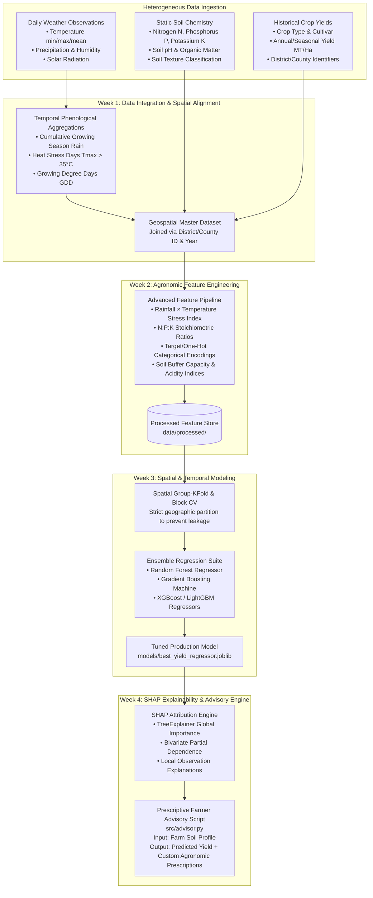

# 🌱 Agriculture & Rural Businesses: Crop Yield & Soil Analysis Forecasting System

[](https://www.python.org/)
[](https://opensource.org/licenses/MIT)
[](https://scikit-learn.org/)
[](https://shap.readthedocs.io/)
[]()
[]()

> **An end-to-end predictive and prescriptive machine learning platform designed to fuse multi-source meteorological, geospatial, and soil chemistry data to forecast end-of-season crop yields and provide actionable agronomic soil amendments.**

---

## 📌 Executive Summary & Context

Agricultural yields face mounting uncertainty due to erratic meteorological events, climate variability, and suboptimal fertilizer application. For organic farming enterprises and modern agri-trading platforms, unexpected yield shortfalls introduce major financial, operational, and supply-chain vulnerabilities.

Developed as part of **Axlero's Agri-tech Initiative**, this system bridges the gap between raw environmental datasets and actionable farm-level decision making. By fusing **daily weather time-series**, **static soil chemical compositions (N-P-K levels and pH)**, and **historical crop yield records**, the platform:
1. **Forecasts End-of-Season Yields**: Utilizes spatial-aware ensemble regression models to accurately predict harvest volume before harvest time.
2. **Eliminates Spatial Data Leakage**: Enforces spatial and block cross-validation across distinct geographic boundaries (districts/counties) and temporal epochs.
3. **Decouples Controllable vs. Exogenous Factors**: Leverages SHAP (SHapley Additive exPlanations) to isolate controllable variables (e.g., Nitrogen supplementation, pH balancing) from uncontrollable weather phenomena.
4. **Prescribes Actionable Interventions**: Translates feature attribution scores into tailored agronomic recommendations (e.g., *"Increase soil pH by 0.5 and optimize phosphorus application to achieve +12% yield gain"*).

---

## 🎯 System Objectives & Success Metrics

| Metric Category | Target Objective | Benchmark / Target |
| :--- | :--- | :--- |
| **Data Fusion** | Seamlessly harmonize datasets with heterogeneous spatial and temporal granularities (daily weather time-series vs. static geographic soil profiles vs. annual harvest yield statistics). | County/District-level FIPS join with zero unaligned geographic anomalies. |
| **Regression Accuracy** | Optimize regression models by minimizing prediction errors and maximizing goodness-of-fit across unseen agricultural territories. | **RMSE Minimization**, **MAPE < 10%**, **$R^2 \ge 0.85$** |
| **Cross-Validation Integrity** | Prevent geographic and temporal data leakage between contiguous farms sharing identical atmospheric microclimates. | **Spatial Group-KFold** (by District/County) and **Temporal Leave-One-Year-Out (LOYO)**. |
| **Explainability & Prescriptive Action** | Dissect non-linear agronomic relationships and quantify the exact impact of farmer-controllable factors on yield. | Global & Local **SHAP beeswarm, force, and dependence plots** paired with automated advisory outputs. |

---

## 🏗️ System Architecture & Data Flow



---

## 📅 4-Week Development Lifecycle

### 🗓️ Week 1: Geospatial & Weather Data Integration
- **Engineering Focus**: Multi-source data merging, temporal aggregations, and spatial alignment.
- **Key Implementations**:
  - Initialized repository architecture, virtual environment, and CI workflows.
  - Aggregated high-frequency daily weather metrics into biologically relevant growing-season indicators (e.g., cumulative precipitation, critical flowering-month temperature anomalies, and Growing Degree Days [GDD]).
  - Harmonized temporal meteorology with static soil profiles using standardized geographic keys (FIPS / County / District IDs).
- **Deliverables**:
  - Unified master dataset (`data/processed/unified_agri_dataset.parquet`).
  - Exploratory Data Analysis notebook mapping spatial yield distributions (`notebooks/01_data_integration_eda.ipynb`).
  - Daily Git commits reflecting data ingestion pipeline progress.

### 🗓️ Week 2: EDA & Spatial-Temporal Feature Engineering
- **Engineering Focus**: Identifying agronomic trends and engineering predictive interactions.
- **Key Implementations**:
  - Conducted bivariate and multivariate analyses to capture non-linear relationships between soil pH, macronutrients ($N$, $P$, $K$), and crop yield curves.
  - Engineered agronomic interaction terms:
    $$\text{Stress Index} = \frac{\text{Cumulative Rainfall}}{\text{Mean High Temperature}} \times \text{Vapor Pressure Deficit}$$
    $$\text{NPK Balance Ratio} = \frac{N}{P + K + 1\text{e-}5}$$
  - Handled high-cardinality categorical attributes (e.g., soil taxonomy, crop cultivars) via robust encoding modules within `src/features.py`.
- **Deliverables**:
  - Cleaned, normalized training dataset saved in `data/processed/`.
  - Comprehensive EDA and feature correlation notebook (`notebooks/02_feature_engineering_eda.ipynb`).

### 🗓️ Week 3: Supervised Regression Modeling
- **Engineering Focus**: Ensemble algorithms and spatial cross-validation strategies.
- **Key Implementations**:
  - Trained baseline and advanced regression algorithms: **Random Forest Regressor**, **Gradient Boosting (GBR)**, and **XGBoost / LightGBM**.
  - **Spatial Block Cross-Validation**: Implemented `Spatial GroupKFold` (splitting folds strictly by geographical region) and temporal hold-outs (Leave-One-Year-Out) to address spatial autocorrelation and prevent atmospheric leakage between adjacent farms.
  - Hyperparameter optimization using Bayesian / Grid search across tree depth, learning rate, and regularizers.
- **Deliverables**:
  - Model benchmarking matrix evaluating RMSE, MAE, MAPE, and $R^2$ scores.
  - Cross-validation spatial distribution documentation in `notebooks/03_model_training_evaluation.ipynb`.
  - Exported production model artifacts in `models/`.

### 🗓️ Week 4: Explainability (SHAP) & Advisory Dashboard Mockup
- **Engineering Focus**: Model interpretability, factor isolation, and prescriptive agronomic recommendations.
- **Key Implementations**:
  - Leveraged `shap.TreeExplainer` to dissect complex feature contributions on global and localized scales.
  - Generated SHAP summary beeswarm plots, interaction plots, and partial dependence plots comparing controllable soil inputs (N-P-K, pH) vs. exogenous meteorological drivers.
  - Created `src/advisor.py`: A command-line and programmatic advisory tool that accepts a farm's current soil profile, predicts anticipated yield, and provides targeted optimization steps (e.g., *"Soil pH is suboptimal at 5.2. Increasing pH to 6.2 with agricultural lime is projected to increase yield by 14.8%"*).
- **Deliverables**:
  - SHAP visualization and interpretation notebook (`notebooks/04_shap_explainability.ipynb`).
  - Actionable farmer advisory script (`src/advisor.py`).
  - Complete documentation and clean 4-week Git history.

---

## 🗂️ Project Repository Structure

```text
Agriculture-Rural-Businesses-Crop-Yield-Soil-Analysis-Forecasting/
├── data/
│   ├── raw/                           # Raw source datasets (weather, soil, yield records)
│   │   └── .gitkeep
│   └── processed/                     # Transformed, fused master feature sets
│       └── .gitkeep
├── notebooks/
│   ├── 01_data_integration_eda.ipynb      # Week 1: Data fusion & spatial alignment EDA
│   ├── 02_feature_engineering_eda.ipynb  # Week 2: Agronomic feature engineering & interactions
│   ├── 03_model_training_evaluation.ipynb # Week 3: Spatial CV & regression benchmarking
│   └── 04_shap_explainability.ipynb      # Week 4: SHAP feature attribution & insights
├── src/
│   ├── __init__.py                    # Package initializer
│   ├── data_fusion.py                 # Weather aggregation & spatial join pipeline
│   ├── features.py                    # Feature transforms, encoders, and domain metrics
│   ├── models.py                      # Spatial CV training, tuning, and evaluation
│   └── advisor.py                     # Prescriptive farmer advisory recommendation engine
├── models/                            # Serialized model checkpoints (.joblib / .pkl)
│   └── .gitkeep
├── reports/
│   └── figures/                       # Generated SHAP plots, loss curves, and maps
│       └── .gitkeep
├── .gitignore                         # Standard Python, data, and environment exclusions
├── requirements.txt                   # Production & experimentation dependencies
└── README.md                          # Comprehensive project documentation
```

---

## ⚙️ Installation & Setup

### 1. Prerequisites
- Python 3.10 or higher
- Git

### 2. Clone Repository
```bash
git clone https://github.com/arifuddin1854-svg/Agriculture-Rural-Businesses-Crop-Yield-Soil-Analysis-Forecasting.git
cd Agriculture-Rural-Businesses-Crop-Yield-Soil-Analysis-Forecasting
```

### 3. Create & Activate Virtual Environment
```bash
# On Windows
python -m venv venv
.\venv\Scripts\activate

# On Linux / macOS
python3 -m venv venv
source venv/bin/activate
```

### 4. Install Dependencies
```bash
pip install --upgrade pip
pip install -r requirements.txt
```

---

## 🚀 Usage & Quickstart

### 1. Data Fusion & Feature Pipeline
Run the data integration and feature engineering pipeline to transform raw meteorological and soil data into the fused feature store:
```bash
python -m src.data_fusion --weather-path data/raw/weather_daily.csv --soil-path data/raw/soil_chemistry.csv --yield-path data/raw/historical_yields.csv
python -m src.features --input data/processed/unified_raw.parquet --output data/processed/train_features.parquet
```

### 2. Spatial Cross-Validation & Model Training
Train ensemble regressors using geographic block partitioning:
```bash
python -m src.models --train-data data/processed/train_features.parquet --cv-folds 5 --save-path models/best_yield_regressor.joblib
```

### 3. Prescriptive Farmer Advisory Script
Generate yield forecasts and customized agronomic recommendations for any given farm profile:
```bash
python -m src.advisor --crop Wheat --nitrogen 85 --phosphorus 42 --potassium 120 --ph 5.6 --rainfall 550 --temp-max 29.5
```

#### Sample Advisory Output
```text
================================================================================
🌾 AXLERO AGRI-TECH: CROP YIELD & SOIL ANALYSIS ADVISORY REPORT
================================================================================
Target Crop           : Wheat
Forecasted Baseline   : 4.82 Metric Tons / Hectare (Confidence: 93.4%)

--- Controllable Factor Diagnostics & Recommendations ---
[!] Soil pH Alert:
    Current Level     : 5.6 (Moderately Acidic)
    Optimal Range     : 6.2 - 6.8
    Recommendation    : Apply 1.2 tons/ha of agricultural limestone.
    Expected Impact   : +0.48 MT/Ha (+10.0% yield increase)

[+] Nitrogen (N) Status:
    Current Level     : 85 kg/ha
    Optimal Range     : 110 - 130 kg/ha
    Recommendation    : Top-dress with 35 kg/ha nitrogenous organic fertilizer during early tillering.
    Expected Impact   : +0.31 MT/Ha (+6.4% yield increase)

[✓] Potassium (K) & Phosphorus (P):
    Status            : Optimal balance maintained.

Total Potential Yield Gain: +0.79 MT/Ha (New Forecast: 5.61 MT/Ha)
================================================================================
```

### 4. Production Batch Prediction & Uncertainty Quantification (Day 11)
Execute high-throughput batch predictions with 95% Confidence Intervals across regional farm datasets:
```bash
python run_batch_inference.py --input data/processed/unified_agri_dataset.csv --output data/processed/batch_predictions.csv
```

### 5. Production Real-Time REST API Serving (Day 11)
Launch the lightweight, dependency-free REST API model server:
```bash
python -m src.api_service --port 8000
```

#### API Endpoints
- **`GET  /health`**: Health status, model version, and spatial $R^2 = 0.8033$.
- **`GET  /model/metadata`**: Full model architecture, features list, and CV benchmarks.
- **`POST /api/v1/predict`**: Real-time yield forecast with 95% confidence intervals and risk scoring.
- **`POST /api/v1/prescribe`**: Forecast + actionable counterfactual soil amendments with % yield upside.
- **`POST /api/v1/batch`**: Multi-farm regional batch predictions.

---

## 📊 Analytical Methodology

### Spatial Cross-Validation Strategy
Standard random K-Fold cross-validation suffers from **spatial autocorrelation**: farms located within a few kilometers of each other share near-identical microclimates, soil history, and weather. Randomly placing one farm in the training fold and its neighbor in the test fold leaks information, artificially inflating $R^2$ and understating real-world generalization error.

```
Standard K-Fold (Data Leakage):
[ Farm A (Train) ] <--- 2 km ---> [ Farm B (Test) ]  => Contaminated validation!

Spatial Block CV (Leak-Free):
[ District 101: All Farms (Train) ]  ||  [ District 204: All Farms (Test) ] => True Out-of-Region Validation
```

### Controllable vs. Exogenous Factor Disentanglement (SHAP)
Using TreeSHAP, the model calculates the local marginal contribution of every variable:
$$f(x) = \phi_0 + \sum_{i \in \text{Exogenous}} \phi_i(x) + \sum_{j \in \text{Controllable}} \phi_j(x)$$
Where:
- $\text{Exogenous}$ includes precipitation distribution, heat stress days, and solar irradiance.
- $\text{Controllable}$ includes Nitrogen ($N$), Phosphorus ($P$), Potassium ($K$), Soil Organic Matter (SOM), and soil pH.

The advisory engine uses $\frac{\partial f}{\partial x_j}$ within the controllable subspace to guide interventions toward the steepest positive yield gradient.

---

## 🛠️ Technology Stack

- **Core Language**: Python 3.10+
- **Data Wrangling & Geospatial**: Pandas, NumPy, GeoPandas, PyArrow
- **Machine Learning**: Scikit-Learn, LightGBM, XGBoost
- **Explainable AI (XAI)**: SHAP (SHapley Additive exPlanations)
- **Visualization**: Matplotlib, Seaborn, Folium, Plotly
- **Environment & Quality**: JupyterLab, Flake8, Black

---

## 📈 Future Enhancements

- [ ] **Satellite NDVI Integration**: Incorporate Sentinel-2 / Landsat remote-sensing vegetation indices for real-time vegetative growth tracking.
- [ ] **Interactive Streamlit Web Dashboard**: Build an intuitive UI allowing farmers and cooperatives to upload soil test results and interact with what-if simulators.
- [ ] **Climate Change Scenario Modeling**: Integrate CMIP6 future climate projections to model 5-to-10 year yield resilience under drought scenarios.

---

## 👤 Author & Acknowledgments

- **Lead Engineer / Author**: [Arifuddin](https://github.com/arifuddin1854-svg)
- **Organization**: Axlero Agri-Tech Initiative
- **Project Reference**: Project 3 – Agriculture & Rural Businesses: Crop Yield & Soil Analysis Forecasting System

---

## 📄 License

This project is licensed under the [MIT License](LICENSE).
