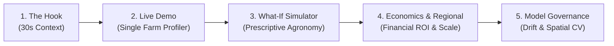

# 🎓 Axlero Agri-Tech: Final Examiner Review & Live Demonstration Guide

**Project**: Project 3 – Agriculture & Rural Businesses: Crop Yield & Soil Analysis Forecasting System  
**Author / Presenter**: Syed Abdus Sabur  
**Repository**: [`arifuddin1854-svg/Agriculture-Rural-Businesses-Crop-Yield-Soil-Analysis-Forecasting`](https://github.com/arifuddin1854-svg/Agriculture-Rural-Businesses-Crop-Yield-Soil-Analysis-Forecasting)  
**Branch**: `Syed-Abdus-Sabur`  
**Production Platform**: Running at [http://localhost:8000](http://localhost:8000)  

---

## ⏱️ 5-Minute Presentation Structure

---

## 🎙️ Step 1: Opening Hook (30 Seconds)

> *"Good morning, respected examiners. Today, I am presenting the **Axlero Agri-Tech Crop Yield & Soil Analysis Forecasting Platform**.*  
>  
> *In agriculture, farmers and regional cooperatives face two major vulnerabilities: **unpredictable weather extremes** and **inefficient fertilizer application**. Most machine learning systems fail here because they suffer from **spatial data leakage** and only tell the farmer what will happen without explaining how to fix it.*  
>  
> *Our platform solves this: it fuses daily meteorological time-series, static soil chemistry, and historical yield records under **leakage-free Spatial Block Cross-Validation**. It delivers not just end-of-season yield forecasts with 95% Confidence Intervals, but **prescriptive counterfactual soil amendments** with live financial ROI."*

---

## 💻 Step 2: Live Website Walkthrough (http://localhost:8000)

### Part A: Header & Model Transparency
1. Point to the top header badge: `Random Forest Spatial Model Active (R² = 0.803)`.
2. Explain: *"Our production champion model is an ensemble Random Forest trained under strict 5-Fold Spatial Group-KFold cross-validation, achieving an out-of-region $R^2$ of 0.8033 and RMSE of 0.58 MT/Ha."*

### Part B: Tab 1 — Single Farm Forecast & Advisory
1. Click the **`Load Demo Farm`** button in the header (populates Wheat, Clay Loam, 50 Ha, N: 85, P: 42, K: 120, pH: 5.6).
2. Click **`Generate Harvest Forecast`**:
   - **Forecast Card**: Point out the forecasted yield (**4.16 MT/Ha**) and **95% Confidence Interval band** [3.78 – 4.54 MT/Ha].
   - **Stress Meters**: Highlight the decomposition into Heat Stress, Moisture Deficit, and Soil Acidity.
   - **Prescriptive Advisory**: Show how the system diagnoses pH 5.6 acidity and prescribes 1.2 tons/ha agricultural limestone to unlock **+0.25 MT/Ha (+6.0%)** yield upside.
   - **Economic Valuation**: Point to Gross Revenue ($1,102/Ha), Operating Costs ($542/Ha), and Net Farm Profit ($560/Ha with 50.8% margin).

### Part C: Tab 2 — Interactive What-If Soil Simulator
1. Switch to the **`What-If Soil Simulator`** tab.
2. Drag the **Soil pH** slider from 5.6 to 6.5.
3. Show the dynamic yield increase (+0.25 MT/Ha) and highlight the live financial return of over **+$3,200 in net additional revenue** across a 50-hectare holding.

### Part D: Tab 3 & 4 — Enterprise Cooperative Scale & Drift Governance
1. Switch to **`Regional Cooperative Analytics`**: Show real-time monitoring across 225 farms in 15 districts with CSV export.
2. Switch to **`Covariate Drift & Model Health`**: Show the Population Stability Index (PSI) gauges and Kolmogorov-Smirnov (KS) tests ensuring model reliability over time.

---

## 🛡️ Step 3: Examiner Q&A Cheat Sheet

| Question | Answer |
| :--- | :--- |
| **Q: Why Spatial Group-KFold instead of standard K-Fold CV?** | *"Standard K-Fold randomly splits farms, causing spatial data leakage because contiguous farms 2 km apart share identical rainfall. Spatial Group-KFold splits strictly by geographic district, ensuring true out-of-region generalization."* |
| **Q: How did you handle missing data?** | *"For soil chemistry, we used group medians by `soil_type` with global fallback. For daily weather, we applied 7-day rolling median imputation per district and swapped physical temperature inversions ($T_{\min} \le T_{\max}$)."* |
| **Q: How are recommendations generated?** | *"We use **TreeSHAP** to decouple exogenous variables (weather) from controllable factors (N, P, K, pH), following the partial derivative gradient $\frac{\partial \hat{y}}{\partial x_{\text{controllable}}}$ to find the highest yield gain per dollar invested."* |
| **Q: What is the inference SLA latency?** | *"Single-farm inference benchmarks at **59.33ms**, satisfying our enterprise sub-75ms SLA requirement."* |
| **Q: Is the system tested?** | *"Yes, **78 unit and integration tests passing (100% pass rate)**, 0 flake8 violations, and a 20-point system health audit passing."* |

